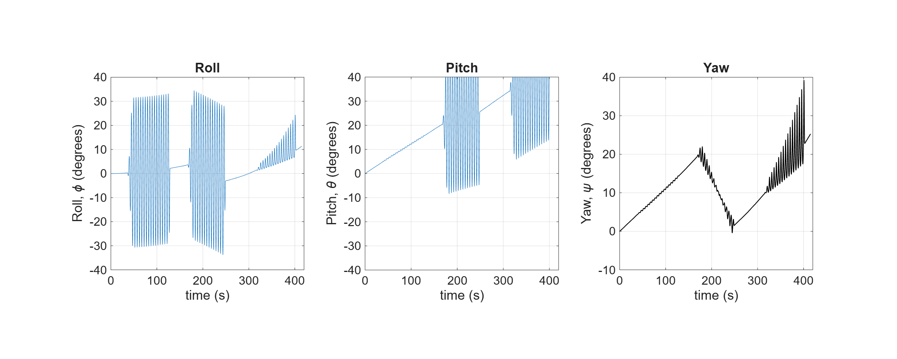
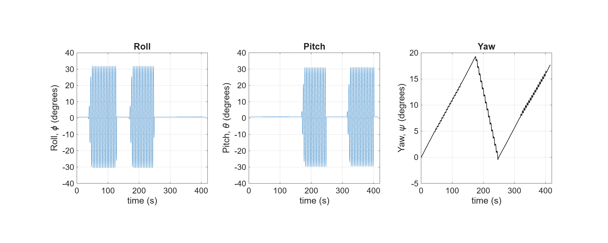

# Kalman Filtering
Discrete-time Kalman filtering for linear systems. Includes a [report](assets/main.pdf) deriving the filter, proving its optimality and the convergence of its error covariance and gain, and MATLAB code.

# MATLAB Example
The MATLAB example uses gyroscope data to estimate roll, pitch, and yaw. The accelerometer helps correct roll and pitch as measurements. The sensor data come from the [Kalman filter tutorial video](https://www.youtube.com/watch?v=DbE4PMgqp3s), and the MATLAB code follows the implementation shown there.

Run [`integrate.m`](integrate.m) in MATLAB to reproduce the gyroscope-only integration plot below.

Run [`kalman.m`](kalman.m) to reproduce the Kalman filter plot, which shows the closer estimate of the actual orientation.

## References
- [Kalman filter tutorial (YouTube)](https://www.youtube.com/watch?v=DbE4PMgqp3s) — The MATLAB example in this repository follows the implementation shown in this video.